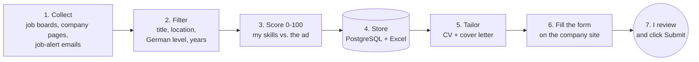

# Job Hunter

Job Hunter is my personal job-search pipeline for data roles in Germany. Every 30 minutes it collects new
postings, drops the ones I can't get, scores the rest against my skills, writes a tailored CV and cover
letter, and opens the application form already filled in. I read everything and click Submit myself.

Built with Python, PostgreSQL, Docker, GitHub Actions, the Claude API and Playwright.

## How it works



1. **Collect.** Reads public job feeds and the job-alert emails that LinkedIn, StepStone and XING send me.
2. **Filter.** Drops jobs with the wrong title, outside Germany, needing B2/C1 German or 4+ years.
   Every dropped job keeps its reason, so the filters can be checked.
3. **Score.** Gives each remaining job a match score from 0 to 100 (see below).
4. **Store.** Saves jobs in a database and in `data/applications.xlsx`. Reposts and the same job on two
   sites are recognised, so I never apply twice.
5. **Tailor.** For the best new matches it writes a one-page CV and a cover letter, using only facts
   from my profile.
6. **Fill the form.** `apply.bat` opens the company's application form with my details, CV, letter and
   standard answers filled in.
7. **Submit.** Always by me. The tool never clicks Submit.

## What it never does

- It never submits an application.
- It never logs in to LinkedIn, StepStone, XING or Indeed, and never clicks anything there. It only reads
  their alert emails and public job pages, a few per run.
- It never adds a skill or experience I don't have. Missing tools are named honestly in the letter.

## Job sources

| Source | What it gives | How it is read |
|---|---|---|
| Company career pages (Greenhouse, Lever, Ashby, Personio, SmartRecruiters, Workday) | Jobs at companies I chose, from startups to Bosch and Delivery Hero | Public job-board feeds |
| Amazon (amazon.jobs) | Amazon and AWS jobs in Germany | Amazon's public job search |
| Bundesagentur für Arbeit | Jobs from all of Germany (also what "Make it in Germany" shows) | Public job-search API |
| Arbeitnow | English-speaking jobs in Germany | Public API |
| Data Berlin (databerlin.net) | About 1,000 Berlin data and AI jobs, with the employer's apply link | Public web pages |
| LinkedIn, StepStone, XING, Indeed, Glassdoor | Jobs from my saved job alerts | Alert emails in Gmail (read-only) |

For good matches from LinkedIn or StepStone, Job Hunter also looks for the same job on the company's own
careers site, so I apply there instead of on the job board.

## How a job is scored

| Part | Points | What it checks |
|---|---|---|
| Tools | 60 | How many of the tools in the ad I have. "Airflow, Dagster or similar" counts as a match if I have one. Nice-to-haves count half. |
| Title | 15 | The title is one of my target roles |
| Experience | 10 | The years asked for fit my level |
| Language | 15 | English is the working language |

Rough guide: 85+ apply first, 70-84 good, 55-69 worth a look. Jobs below `min_score` (55) are hidden.
A `?` means the ad text could not be read yet, so the job is not scored.

## Getting started (Windows)

You need Docker Desktop and Python 3.11+.

1. Get the code:
   ```bash
   git clone https://github.com/Nandavits/Job-hunter.git
   cd Job-hunter
   ```
2. Copy the three example files and fill them in:
   - `config/profile.example.yaml` → `config/profile.yaml`: your CV data and form answers
   - `config/config.example.yaml` → `config/config.yaml`: job titles, skills, locations, companies
   - `.env.example` → `.env`: your Claude API key and Gmail app password (both optional)
3. Double-click **`start-jobhunter.bat`**. It starts the database and the scheduler, checks every job
   source and runs the first search. From then on it runs every 30 minutes while the computer is on.
4. In Docker Desktop, turn on *Settings → General → Start Docker Desktop when you sign in*.

Without an API key everything still works. Letters then come from a simple template.

## Applying to a job

1. Close Excel.
2. Double-click **`apply.bat`**. It shows your jobs, best first, and tests the Claude key.
3. Type a job's ID and press Enter.
   - Jobs marked `[company site found]`: just press Enter at the link question.
   - Other job-board jobs: open the job, click Apply, and paste the company's link.
4. A browser opens with the form filled in. Check it, tick the consent box and click **Submit**.
5. In the black window, type **y**. The job moves to "applied" in Excel.

Fields the tool could not answer are listed under "Needs your answer". Personal questions it has no
answer for get "Prefer not to say".

## The Excel tracker

`data/applications.xlsx` is rewritten after every run, with three sheets: **Applications**, **Open jobs**
and **All jobs** (with the reason each job was skipped). You can change a Status or Notes cell, for
example to mark a job you applied to on LinkedIn, and the next run reads it back.

## Running in the cloud (laptop off)

A private copy of the settings can run on GitHub Actions every hour from about 06:00 to 22:00. It collects
and scores jobs, prepares documents and emails a short list of new matches. Applying still happens on the
laptop. Keys are stored as GitHub secrets, never in files.

## Writing style

Cover letters and form answers use short, plain sentences and concrete facts. About 50 typical AI phrases
("excited", "leverage", "perfect fit" and similar) are banned. If one slips in, the letter is rewritten once.
See `jobhunter/style.py`.

## Commands

```bash
python -m jobhunter run                 # one full search
python -m jobhunter list                # open jobs, best first
python -m jobhunter show <id>           # full ad and why it matched
python -m jobhunter fill <id>           # open the pre-filled form (apply.bat does this)
python -m jobhunter mark <id> interview --note "Call on Tuesday"
python -m jobhunter add --url <link> --company Acme --title "Data Engineer" --description-file ad.txt
python -m jobhunter discover <careers-page-url> --name Acme   # find a company's job board
python -m jobhunter check-sources       # test every job source
python -m jobhunter check-key --letters # test the Claude key with one sample letter
python -m jobhunter stats
```

## Project structure

```
jobhunter/
  collectors/     one file per source: ats.py (Greenhouse, Lever, Ashby, Personio, SmartRecruiters,
                  Workday), amazon.py, arbeitsagentur.py, arbeitnow.py, databerlin.py, email_alerts.py
  filters.py      title, location, German level, years, match score
  dedupe.py       same job across reposts and job boards
  career.py       finds the company's own application page for job-board matches
  storage.py      database and status tracking
  excel.py        applications.xlsx, read and written
  tailor.py       CV and letter tailoring with Claude, template fallback
  style.py        writing rules and banned phrases
  documents.py    one-page CV and letter as .docx and PDF
  autofill.py     fills application forms, never submits
  notify.py       email digest
  pipeline.py     runs the steps in order
  __main__.py     command line
config/           example settings (your real ones are git-ignored)
tests/            140 tests with recorded API answers and sample forms
start-jobhunter.bat, apply.bat   one-click start and apply on Windows
```

## Updates

Changes in `jobhunter/`, `config/` and `.env` are used from the next run. Only changes to
`requirements.txt`, the `Dockerfile` or `docker-compose.yml` need `start-jobhunter.bat` again.

## Tests

```bash
pytest -q
```

They cover every source's parsing, the German-level check, scoring, duplicate detection, the form filler
(including that it never submits), the writing-style check and a full run on recorded data.

## Privacy

`config/profile.yaml`, `config/config.yaml`, `.env`, `data/` and `output/` are git-ignored. Personal data,
keys, the job database and generated documents stay on your computer.

## License

MIT. You can use and change it for your own job search.
